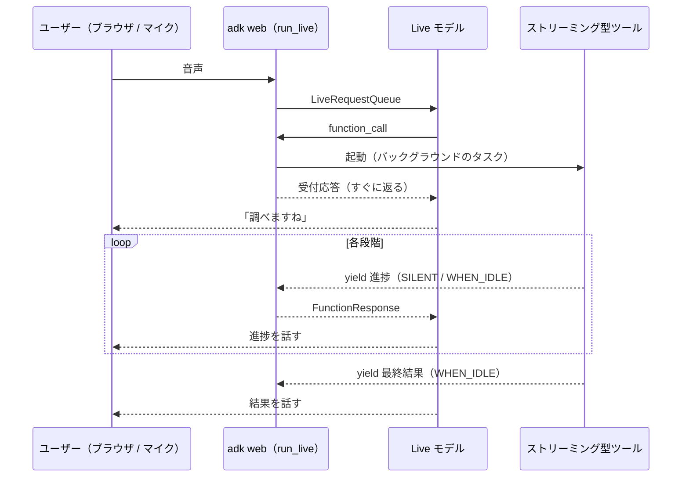

# ADK Voice Agent（黙らない汎用音声チャット）

## 技術ゴール & 制約（ブレ防止）

### 最優先ゴール

- 汎用の音声チャットで、遅いツールの実行中もエージェントが沈黙しない（最初の応答まで数秒以内）。ツールを足しても、同じ型に当てはめるだけでこの性質が保てる
- バックエンドの処理時間そのものは短縮対象にしない

### スコープ外

- 実際の外部サービスとの接続（サンプルのツールは `asyncio.sleep` で模擬する）
- 会話履歴の永続化（`adk web` 標準のメモリ上のセッションのみ）
- 電話網（SIP / PSTN）との接続、ターミナルからの音声入出力
- 認証・マルチユーザー・スケールアウト

### 絶対制約

- Python、`google-adk >= 2.10.0`（`behavior=NON_BLOCKING` と、進捗ごとのスケジューリング指定が前提）
- 双方向ライブセッション（`Runner.run_live`）で動かす。`run_async` では非ブロッキングツールが成立しない
- モデルは `gemini-3.8-live`（Gemini API キーで利用する）

## ユースケース

### UC-001: 汎用の音声会話

- ツールを使わない雑談・質問応答。途中で話して遮れる
- ほとんどのターンはこれで、手法が効くのはツールが遅いときだけ
- 日本語と英語に対応し、ユーザーの直前の発話の言語で返す。「OK」のような短い発話や言語が曖昧な発話では、それまでの言語を保つ
- 口調はフレンドリーにする（日本語は丁寧語ベースのくだけた話し方、英語はカジュアル）
- 言語の切り替えは instruction で行い、`speech_config` で出力言語を固定しない

### UC-002: 段階のある長時間処理を、進捗を話しながら実行する（ストリーミング型）

- サンプル: 調べ物（検索 → 読む → まとめる、合計約13秒）
- ツールを async generator にして、段階ごとに `yield` する。ADK はすぐに受付応答を返し、モデルは届いた進捗を話す
- 実行中も会話は続けられる。遮って話してもツールは止まらず、結果は後から届く
- モデルが `stop_streaming` を呼ぶと、ADK がタスクをキャンセルする。ツールは `asyncio.CancelledError` を受けて後始末する

### UC-003: 途中経過のない待ちを、バックグラウンドで実行する（バックグラウンド型）

- サンプル: 外部 API の照会（約8秒）
- 普通の coroutine を `NON_BLOCKING` の `FunctionTool` として登録する
- 結果は今の発話が終わったところ（idle）で伝えられる

### UC-004: 同期ツールとの比較（ベースライン）

- UC-002 と同じ処理を普通の同期ツールでも用意し、最初の応答までの時間を比べる（記事の計測値: 14.4秒 → 1.2秒）

## アーキテクチャ

### 現状（before）

- 該当なし（`uv init` しただけの Python 3.13 プロジェクト）

### 今回の構成（after）

#### コンポーネント

| モジュール | 責務 |
| --- | --- |
| `voice_agent/agent.py` | `root_agent` の定義（モデル、汎用チャット向けの instruction、ツールの登録） |
| `voice_agent/tools/_common.py` | 型ごとの共通部品。`@streaming_tool`（二重起動の防止、キャンセル時の後始末、エラーの伝達）と `background_tool()`（`NON_BLOCKING` の `FunctionTool` を作る） |
| `voice_agent/tools/samples.py` | 模擬のサンプルツール（UC-002〜004）。差し替え前提 |
| `adk web`（ADK 付属） | ブラウザで音声を入出力し、`run_live` を実行する開発用 UI |

個々のツールは処理の中身だけを書き、沈黙しないための振る舞いは `_common.py` に集める。

#### データの流れ（ストリーミング型）

#### 結果を伝えるタイミング（response scheduling）

| 値 | 動き | 使いどころ |
| --- | --- | --- |
| `SILENT` | 会話履歴に入れるだけで、発話は促さない | 細かい途中経過 |
| `WHEN_IDLE` | 今の発話が終わってから伝える | 段階の区切り・最終結果 |
| `INTERRUPT` | 今の発話を遮って伝える | 失敗・緊急の通知 |

#### 共通部品の振る舞い

- 二重起動: docstring に「1回だけ呼ぶこと」と書き、さらにツール名と引数をキーにしたメモリ上のフラグで、実行中の再呼び出しには「実行中」とだけ返す
- キャンセル: `CancelledError` を受けたら後始末をしてから再送出する
- 失敗: 例外は `{"status": "error"}` に変換し、`INTERRUPT` で伝える
- 話させる進捗は途中の1回だけ（`WHEN_IDLE`）にし、残りは `SILENT` にする。毎回話させると「待ってね」を繰り返し、結果の発話も遅れる
- `stop_streaming` は ADK が自動で用意しないため、同名のツールを登録する。モデルが自分から呼ぶことがあるので、「ユーザーが明示的に止めるよう頼んだときだけ」と docstring と instruction の両方に書く
- 言語: ツールが返す進捗や結果は、自然文ではなく構造化データ（`{"stage": "searching", "progress": 1, "total": 3}` など）にする。会話の言語に合わせて言い換えるのはモデルの役割にする

### 将来の理想構成（ideal）

- サンプルを実際のツール（Web 検索、社内 API など）に置き換える
- ターミナルから音声で会話する CLI クライアント（`run_live` を自前で回し、`sounddevice` でマイクとスピーカーを使う。エコーキャンセルがないためイヤホンが前提）
- 会話履歴の永続化

今回は手法の検証を優先するため、いずれも作らない。

## ツールの追加手順

1. 処理時間で型を選ぶ

   | 処理 | 型 |
   | --- | --- |
   | すぐ終わる（目安 1〜2秒以内） | 普通の関数ツール |
   | 段階があり、進捗を話せる | ストリーミング型（`@streaming_tool` を付けた async generator） |
   | 待つだけ | バックグラウンド型（`background_tool(func)`） |

2. docstring に、モデルが呼ぶ条件と「1回だけ呼ぶこと」を書く
3. `agent.py` の `tools` に登録する

### ADK 2.12 で確認した挙動

- async generator のツールは自動で `NON_BLOCKING` として宣言され、呼び出し直後に「pending」の応答が返る。`yield` した値はそのまま FunctionResponse としてモデルへ送られる
- `types.FunctionResponse(response=..., scheduling=...)` を yield すると、その1回分だけ伝えるタイミングを変えられる
- バックグラウンド型は `FunctionTool` の生成後に `behavior` と `response_scheduling` を属性で設定する（コンストラクタは受け取らない）
- 同名のストリーミングツールが再度呼ばれると、ADK は古いタスクを止めずに記録だけ上書きする
- ストリーミングツールの例外は、ADK が汎用のエラー応答に変換してモデルへ返す
- `will_continue`（応答が続くことを示す項目）は Vertex AI では使えない。今回は Gemini API キーを使うので問題ない

## 技術選定のトレードオフ

| 論点 | 採用 | 不採用 | 理由 |
| --- | --- | --- | --- |
| 段階のある処理 | ストリーミング型（`yield`） | バックグラウンド型 | 進捗を話せるので、沈黙を最も短くできる |
| 段階のない処理 | `NON_BLOCKING` | ストリーミング型で1回だけ `yield` | 普通の関数のまま書けて、意図も明確 |
| 振る舞いの置き場所 | 共通部品（デコレータ） | 各ツールに直接書く | ツールが増えても、沈黙しない性質を同じ実装で保てる |
| 音声の入出力 | `adk web` | 自作の Web UI / CLI クライアント | 最優先ゴールの検証にはクライアント実装は不要 |
| 接続先 | Gemini API（API キー） | Vertex AI（Gemini Enterprise） | 同じ `gemini-3.8-live` を使え、準備が軽い。コードは同じで、環境変数だけで切り替えられる |

## 運用

### デプロイ

- ローカルで `uv run adk web` を実行するのみ
- シークレットは `.env`（`GEMINI_API_KEY`、任意で `VOICE_NAME`）に置き、`.gitignore` に入れる
- ADK はシェルの環境変数を `.env` より優先するため、Gemini API キーへの切り替え（`GOOGLE_GENAI_USE_VERTEXAI=FALSE`）は `agent.py` で行う

### 監視と障害対応

- `adk web` のイベントログで、function_call・各 FunctionResponse・発話の時刻を確認する
- 沈黙した場合は、まずツールが async generator または `NON_BLOCKING` として登録されているか、`run_live` で動いているかを確かめる

## 実装ステップ

1. **セットアップ**: `uv add "google-adk>=2.10.0"`、`.env` の作成。ツールなしのエージェントと `adk web` で音声会話できる（UC-001）。日英を切り替えても追従し、選んだ声がどちらの言語でも自然に聞こえる
2. **API の確認**: インストールした ADK で、`behavior` / `response_scheduling` / `stop_streaming` / `types.FunctionResponse` の実際の名前と使い方を確かめる（記事のコードは本文から直接取得できていないため）
3. **比較用の同期ツール（UC-004）**: 約13秒の沈黙が再現できる
4. **共通部品とストリーミング型（UC-002）**: 受付応答と各段階の進捗が話され、最初の応答が数秒以内になる
5. **バックグラウンド型（UC-003）**: 実行中も雑談でき、結果が idle のときに伝えられる
6. **エッジケース**: 遮って話しても結果が届く／二重に呼ばれない／`stop_streaming` で後始末が走る
7. **計測**: 同期版とストリーミング版で、最初の応答までの時間を記録する

### 計測結果（2026-10-22、テキスト入力・音声出力）

| | 最初の発話 | 結果の発話 |
| --- | --- | --- |
| 同期版（`RESEARCH_MODE=blocking`） | 14.6秒 | 14.6秒 |
| ストリーミング版（3回） | 1.6〜2.2秒 | 15.5〜16.8秒 |

ストリーミング版では、実行中の雑談にもすぐ答え、結果は後から伝えられた。

待ち時間は `asyncio.sleep` による模擬のため、同期版の値は模擬の13秒から決まる。手法の効果として見るべきは、ツールの長さによらず最初の発話が約2秒で出る点である。

### 進捗

- ステップ1〜4は完了。UC-003（バックグラウンド型）、エッジケースのうち `stop_streaming` の確認が残り
